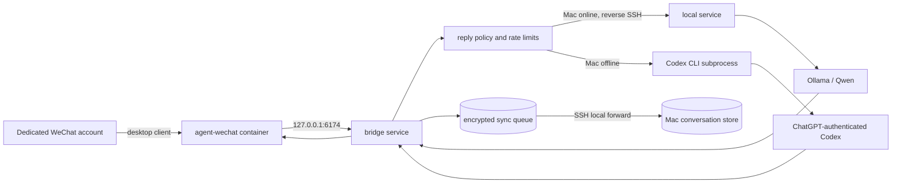

# Architecture and trust boundaries

## Runtime topology

## Components

### `agent-wechat`

An external Linux desktop-client runtime provides a loopback HTTP API and VNC login surface. It needs `SYS_PTRACE` and an unconfined seccomp profile; those elevated permissions apply only to this container. The image is pinned by digest and is not built or redistributed here.

### Bridge service

The Node.js bridge discovers chats, keeps independent cursors, enforces direct-message and group policies, applies sender/rate/message-length controls, dispatches reminders, routes model requests, and sends replies. It runs as a non-root user with a read-only root filesystem and no Linux capabilities.

### Mac local service

The local service binds only to `127.0.0.1:43110`. It stores per-conversation history and calls Ollama. It can add bounded, read-only weather or search results before local inference. The cloud host reaches it only through the SSH reverse tunnel while the Mac is awake.

### Codex fallback

The fallback invokes the official Codex CLI as a subprocess with ChatGPT authentication. Each request uses an ephemeral temporary directory, read-only sandboxing, no approval prompts, and a denylist for shell, browser, app, plugin, image, and multi-agent capabilities. Web search remains enabled for current-information questions.

This containment reduces risk but is not a formal security boundary. Do not expose the bridge as a public multi-tenant service.

## Message policy

1. Discover chats with pagination and derive an immutable chat ID.
2. Exclude official/service sessions and disabled chats.
3. For a group, resolve its explicit override or inherit the group default.
4. In `mention-only`, require native WeChat mention metadata and the configured display name.
5. Apply the global sender allowlist, per-sender cooldown, maximum length, and replies-per-minute cap.
6. Load only the same conversation's bounded recent context.
7. Prefer the Mac route; if unavailable, send the privacy-filtered request to Codex.
8. Send the reply and advance the chat cursor.

New groups require no configuration because step 3 always applies `WECHAT_GROUP_DEFAULT_MODE` when no override exists.

## Stored data

| Location | Data | Protection |
| --- | --- | --- |
| WeChat container volumes | Login state, client database, media | Host/container controls; not end-to-end encrypted by this project |
| Cloud bridge data | Cursors, encrypted sync queue, reminders | Private directory; message/reminder payloads encrypted with AES-256-GCM |
| Codex auth directory | ChatGPT/Codex cached credentials | `0700` host directory; never committed |
| Mac data directory | Conversation-scoped SQLite history, secrets, logs | Local `0600`/`0700` permissions |

Conversation IDs are derived from a hash of the immutable WeChat chat ID. Human-readable chat IDs are not used as database filenames.

## Network boundary

- `6174`: agent API and VNC, bound to cloud or Mac loopback.
- `43110`: Mac local model/history service, loopback.
- `43111`: cloud sync endpoint, loopback.
- `22`: the only intended public cloud ingress, preferably source-IP restricted.

Never publish ports 6174, 43110, or 43111 through a cloud security group, reverse proxy, or router port-forward.

## Failure behavior

- A `PAUSE` file stops new automatic replies without deleting state.
- Disabled chats advance their cursors so re-enabling does not reply to a backlog.
- New chats begin from their unread tail.
- Login/API failures wait and retry; they do not clear persistent volumes.
- Missing or conflicting policy inputs abort startup or skip sending.
- Model failure returns a short unavailable message rather than silently switching to a metered API provider.
